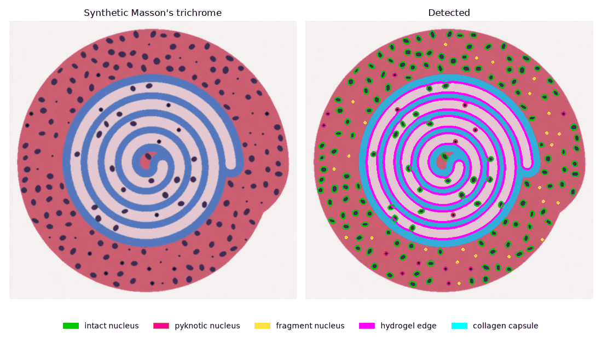

# weaver-histo

Nuclei, cell-state, infiltration, collagen-capsule and construct-geometry measurements from H&E and Masson's trichrome slides of 3D-bioprinted hydrogel constructs.

[](https://github.com/tanushvarma/weaver-histo/actions/workflows/ci.yml) 



The figure is a synthetic section from the test suite, not lab data. Regenerate it with `python -m scripts.make_figures`.

## What it measures

| Group | Metrics |
|---|---|
| Nuclei | count, density, area, shape, darkness, nearest-neighbour spacing, Clark-Evans R |
| Cell state (H&E-level proxies) | pyknosis index, pale-nuclei %, fragments per 100 nuclei, each also split inside vs outside the matrix |
| Infiltration | % cells inside matrix, depth median/p90/max, density in shells inside and outside the edge |
| Fibrosis (trichrome) | collagen area %, collagen inside matrix, capsule thickness median/mean/p90, capsule coverage |
| Construct geometry | matrix area, perimeter, wall thickness, void fraction, number of pieces |

Pyknotic, pale and fragment are morphological proxies. They suggest cell death but do not distinguish apoptosis from necrosis; confirm with TUNEL or cleaved caspase-3.

## Install

Python 3.11 or newer, 64-bit.

Windows (PowerShell):

```powershell
python -m venv .venv
.\.venv\Scripts\Activate.ps1
pip install -e ".[all]"
```

If PowerShell blocks the activation script, run `Set-ExecutionPolicy -Scope Process Bypass` first.

macOS / Linux:

```bash
python -m venv .venv
source .venv/bin/activate
pip install -e ".[all]"
```

`[all]` installs the Streamlit app and SlideIO. For the command line and Python API only, `pip install -e .` is enough; `.vsi` and other whole-slide formats then need `pip install -e ".[vsi]"`. If SlideIO cannot open a particular `.vsi`, export the main scan from QuPath or Fiji as a pyramidal TIFF and open that instead.

## Usage

### Streamlit app

```
streamlit run app/streamlit_app.py
```

Whole-slide mode takes the path to a `.vsi` or large scan, finds the tissue sections on the overview, and analyses each at cell resolution. Large sections are sampled in tiles and the summary reports what fraction of tissue was analysed. Single-image mode takes uploaded PNG, JPG or TIFF regions; enter microns per pixel or results stay in pixels, and upload hand-drawn hydrogel masks named `<image>_mask.png` for final numbers.

The two models are taught in whole-slide mode. In the Teach regions tab, click example spots of glass, host tissue and hydrogel. In the Teach states tab, correct the app's state for a few dozen nuclei. Models are saved in `models/`, keep earlier examples when taught again, and are picked in the sidebar for the next run. Both modes export a summary CSV, a per-nucleus CSV and overlays.

### Command line

```
weaver-histo analyze region1.png region2.png --stain trichrome --um-per-px 0.5 --out results
weaver-histo slide "D:\scans\construct_04.vsi" --stain he --out results\construct_04
weaver-histo --version
```

`analyze` writes `summary.csv` (one row per image), `nuclei.csv` and one overlay PNG per image. `--mask` applies a hand-drawn hydrogel mask. `slide` writes the per-section summary, `nuclei.csv`, an overview and one overlay per section; `--scene` picks a scene inside multi-scene files and `--um-per-px` overrides the pixel size stored in the file. Add `-v` for progress and full tracebacks.

### Python API

```python
from weaver_histo import Params, analyze
from weaver_histo.loading import load_image

rgb, downscale = load_image("region.tif")
result = analyze(rgb, Params(stain="trichrome", um_per_px=0.5 * downscale))
print(result.summary["capsule_thickness_median_um"], len(result.cells))
```

## How it works

1. Optional Macenko or Reinhard stain normalisation, then colour deconvolution into hematoxylin and eosin (H&E) or collagen and red cytoplasm (trichrome).
2. Tissue is separated from glass by optical density. On a whole slide, sections are found on a low-resolution overview by hue, which excludes label cards and ink.
3. Each section is read twice: a coarse map (about 2 um/px) for tissue, hydrogel and collagen, and cell-resolution tiles (0.5 um/px by default) for nuclei. Tiles overlap so nuclei on seams are counted once.
4. Nuclei are thresholded on the nuclear signal and touching nuclei are split by watershed. Size and darkness are measured on each nucleus's half-peak core.
5. The hydrogel is the pale, weakly stained material once nuclei are painted out; its edge is snapped to the half-maximum of the stain signal. The capsule is the collagen in contact with that edge.
6. Each nucleus gets shape, density and texture features and a signed distance to the hydrogel edge. States are assigned relative to the image's typical nucleus, so no absolute calibration is needed.
7. Two scikit-learn random forests can replace the rules: a pixel classifier for glass, host tissue and hydrogel, and a nucleus-state classifier.

## Validation

Tests run on synthetic sections with planted ground truth: a spiral hydrogel, host tissue, a collagen capsule in trichrome, and a known number of nuclei of each state inside and outside the matrix. They check nuclear counts, matrix IoU, capsule thickness, calibration in microns versus pixels, and that results do not change with resolution or tile size. Output of `python -m scripts.run_synthetic` at 1 um/px:

| | H&E planted | H&E found | Trichrome planted | Trichrome found |
|---|---|---|---|---|
| Intact nuclei | 140 | 143 | 140 | 140 |
| Pyknotic nuclei | 15 | 15 | 15 | 15 |
| Pale nuclei | 12 | 9 | 0 | 0 |
| Fragments | 25 | 25 | 25 | 25 |
| Whole nuclei inside matrix | 25 | 27 | 25 | 25 |
| Matrix IoU | | 0.891 | | 0.928 |
| Capsule thickness median (um) | | | 18 | 14.1 |
| Capsule IoU | | | | 0.985 |

Capsule thickness reads low because the gaps between spiral arms cap the measurable width at about 16 um. Validation on real lab slides is in progress.

## Limitations

- Validated on synthetic slides only. Reading a real `.vsi` through SlideIO has not been tested. Check thresholds on your own slides first; the Advanced sliders and the overlay show what was detected.
- Automatic matrix detection assumes the hydrogel is paler than host tissue. If it is not, use hand-drawn masks.
- Capsule thickness assumes the capsule is thinner than the matrix wall and is capped at the search distance.
- Cell-level numbers come from the cell-resolution tiles; a slide overview alone cannot provide them.
- Models trained on one stain or scanner should be re-taught for another.

## Development

```
pip install -e ".[all,dev]"
ruff check .
pytest -m "not slow"
pytest
```

The fast suite runs in under a minute. The slow tests analyse full synthetic slides and take several minutes; CI runs them on pushes to `main`.

## Project layout

```
app/
  streamlit_app.py   entry point, mode switch
  image_mode.py      single-image mode
  slide_mode.py      whole-slide mode and model teaching
src/weaver_histo/
  loading.py         image intake (PNG/JPG/TIFF, 8/16-bit, downscale)
  stains.py          Macenko / Reinhard normalisation, colour deconvolution
  segment.py         tissue, nuclei, matrix and collagen masks
  metrics.py         per-nucleus features, states, infiltration, capsule, geometry
  pipeline.py        analyze(image, Params) -> Result for one image
  readers.py         slide readers (SlideIO and in-memory images)
  sections.py        tissue-section detection on the overview
  slide.py           whole-slide two-scale analysis
  ml.py              trainable pixel and nucleus-state models
  viz.py             overlays and plots
  cli.py             weaver-histo command
scripts/
  make_synthetic.py  write the synthetic test scenes as PNGs
  run_synthetic.py   compare the pipeline against planted ground truth
  make_figures.py    regenerate docs/images/overview.png
tests/
  synthetic.py       synthetic scene and slide generator
  test_*.py          pytest suite
```

## Citation

See [CITATION.cff](CITATION.cff).

## License

License pending lab approval.
